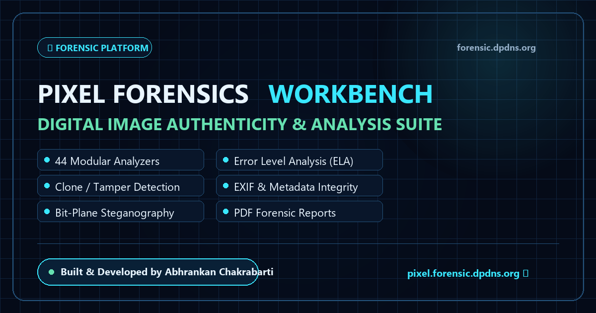

# 🔍 Digital Image Forensics Platform

[](https://github.com/Abhrankan-Chakrabarti/forensic-website/actions/workflows/deploy.yml)
[](LICENSE)
[](https://react.dev/)
[](https://vitejs.dev/)
[](https://tailwindcss.com/)

<p align="center">
  
</p>

A modern, high-performance web portal and client-side forensic inspection suite (`forensic.dpdns.org`), tailored for investigators, OSINT analysts, journalists, and cybersecurity researchers performing digital media authenticity verification. Built & architected by **Abhrankan Chakrabarti**.

---

## 🌐 Live Ecosystem

- **Main Landing Portal & Client Inspector**: [forensic.dpdns.org](https://forensic.dpdns.org) — Features in-browser Error Level Analysis (ELA), EXIF metadata inspection & privacy sanitization, and the interactive Dual-Image Diff Comparator.
- **Pixel Forensics Workbench**: [pixel.forensic.dpdns.org](https://pixel.forensic.dpdns.org) — Dedicated 44-algorithm forensic platform developed by **Omeshwar Bawane** (hosted and deployed on AWS Graviton2 ARM64 by **Abhrankan Chakrabarti**).

---

## ✨ Features & Capabilities

- 🔬 **Error Level Analysis (ELA)**: Detect differences in compression error levels across image regions to reveal digital splices, edits, and recompression traces.
- ⚖️ **Dual-Image Diff Comparator**: Side-by-side and interactive split slider comparisons between an authentic reference image (Slot A) and a suspect modified copy (Slot B).
- 🔥 **Neon Crimson Delta Heatmap**: Real-time pixel-by-pixel difference analysis with an adjustable sensitivity slider (0–100), highlighting tampered, spliced, or digitally doctored pixels in high-contrast neon crimson against a dimmed grayscale base.
- 🎨 **Channel & Edge Filter Isolator**: Multi-wavelength spectral inspection isolating Red, Green, and Blue channels, perceived luminance, inverted negatives, and 3x3 Laplacian spatial convolution for finding sharp splice boundary seams.
- 🔒 **Cryptographic Evidence Checksums**: Automated hardware-accelerated **SHA-256** and **MD5** hashing to verify chain of custody and media integrity without uploading evidence.
- 📑 **Printable Forensic Case Dossier**: One-click generation of audit-ready forensic case reports complete with Case ID, evidence plates, metadata extraction, examiner findings, PDF export, and JSON audit log.
- 🛡️ **In-Browser EXIF & Metadata Sanitizer**: One-click local metadata stripper that cleans GPS coordinates, camera serial numbers, and software signatures, exporting privacy-safe JPEG or PNG files.
- 📊 **Real-time Color & Luminance Histogram**: Live interactive RGB and brightness frequency distribution for detecting color channel clipping or unnatural grading.
- 📋 **Zero-Dependency EXIF Extraction**: Instant browser-side decoding of TIFF/JPEG header structures, camera make/model, timestamps, exposure parameters, and known editing software flags (Photoshop, GIMP, Canva, etc.).
- 🔒 **Zero-Knowledge Privacy Architecture**: 100% client-side HTML5 Canvas and Web API execution — image evidence is processed locally in memory and never transmitted to any external server.
- 📄 **Forensic Export Pipeline**: Direct downloads for computed ELA heatmaps, delta difference maps, and sanitized clean copies.

---

## 🛠️ Tech Stack

- **Framework**: [React 19](https://react.dev/)
- **Build Tool**: [Vite 8](https://vitejs.dev/)
- **Styling**: [Tailwind CSS v4](https://tailwindcss.com/) (using `@tailwindcss/vite`)
- **Linting**: [ESLint](https://eslint.org/)
- **CI/CD**: GitHub Actions automated pipeline with orphaned `build` branch deployment for EC2 Nginx serving

---

## 🚀 Getting Started

### Prerequisites

- [Node.js](https://nodejs.org/) (v18.0.0 or higher recommended)
- `npm`, `pnpm`, or `yarn`

### Installation

1. **Clone the repository**:
   ```bash
   git clone https://github.com/Abhrankan-Chakrabarti/forensic-website.git
   cd forensic-website
   ```

2. **Install dependencies**:
   ```bash
   npm install
   ```

3. **Start the development server**:
   ```bash
   npm run dev
   ```

4. Open your browser and navigate to `http://localhost:5173`.

---

## 📦 Available Scripts

| Command | Description |
| :--- | :--- |
| `npm run dev` | Starts the Vite development server with Hot Module Replacement (HMR). |
| `npm run build` | Builds the production bundle into the `dist/` directory. |
| `npm run preview` | Locally previews the production build. |
| `npm run lint` | Runs ESLint to verify code quality and style standards. |

---

## 📂 Project Structure

```text
forensic-website/
├── .github/
│   ├── ISSUE_TEMPLATE/
│   │   ├── bug_report.md        # Standard bug report template
│   │   └── feature_request.md   # Feature request template
│   └── workflows/
│       └── deploy.yml           # Automated GitHub Actions CI/CD to build branch
├── public/
│   ├── CNAME                    # Custom domain mapping (forensic.dpdns.org)
│   ├── favicon.svg              # Platform vector favicon
│   ├── icons.svg                # System iconography
│   └── og-preview.png           # OpenGraph & social preview banner (1200x630)
├── src/
│   ├── components/
│   │   ├── ChannelFilterView.jsx   # In-browser channel isolator (RGB/Lum/Laplacian)
│   │   ├── DualImageComparator.jsx # In-browser dual-image diff comparator & delta heatmap
│   │   ├── ForensicReportModal.jsx # Case dossier modal with print/PDF & JSON audit export
│   │   ├── Histogram.jsx          # Real-time RGB and luminance distribution visualizer
│   │   └── QuickAnalyzer.jsx      # Tabbed quick inspector (Single ELA & Dual Comparator)
│   ├── utils/
│   │   ├── cryptoUtils.js         # Hardware-accelerated SHA-256 and pure-JS MD5 hashing
│   │   └── exifParser.js          # Zero-dependency JPEG EXIF parser & software detector
│   ├── App.jsx                  # Main landing portal & capability matrix
│   ├── index.css                # Global Tailwind CSS imports
│   └── main.jsx                 # React application entry point
├── CONTRIBUTING.md              # Open-source contribution guidelines
├── eslint.config.js             # ESLint configuration
├── index.html                   # HTML template with SEO & OpenGraph tags
├── package.json                 # Project dependencies and npm scripts
├── vite.config.js               # Vite build configuration with relative base
├── LICENSE                      # MIT License
├── SECURITY.md                  # Security & zero-knowledge privacy policy
└── README.md                    # Project documentation
```

---

## 👨‍💻 Contributors & Authors

- **Abhrankan Chakrabarti** — Platform Architect, Landing Portal Developer, Hosting & Infrastructure Lead
  - [LinkedIn](https://www.linkedin.com/in/abhrankan-chakrabarti-159460214/)
  - [GitHub](https://github.com/Abhrankan-Chakrabarti)
  - [Email](mailto:abhrankan@gmail.com)

- **Omeshwar Bawane** — Pixel Forensics Workbench Lead Algorithm Developer (44 modular forensic algorithms)
  - [LinkedIn](https://www.linkedin.com/in/omeshwar-bawane-b39165383)

---

## 📄 License

Distributed under the **MIT License**. See [`LICENSE`](LICENSE) for more details.
