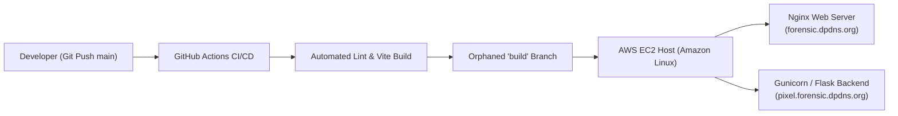

# 🔍 Digital Image Forensics Platform

[](https://github.com/Abhrankan-Chakrabarti/forensic-website/actions/workflows/deploy.yml)
[](LICENSE)
[](https://react.dev/)
[](https://vitejs.dev/)
[](https://tailwindcss.com/)
[](#-zero-knowledge-privacy-architecture)

<p align="center">
  
</p>

A modern, high-performance web portal and client-side forensic inspection suite ([forensic.dpdns.org](https://forensic.dpdns.org)), engineered for digital investigators, OSINT analysts, journalists, and cybersecurity researchers performing digital media authenticity verification. Built and architected by **Abhrankan Chakrabarti**.

---

## 🌐 Live Ecosystem

- **Main Landing Portal & Client Inspector**: [forensic.dpdns.org](https://forensic.dpdns.org) — High-speed client-side forensic workstation featuring Error Level Analysis (ELA), 8-Bit Plane Steganalysis, Dual-Image Diff Heatmapping, EXIF Metadata Inspection & Sanitization, Cryptographic Checksums, and printable Audit Dossiers.
- **Pixel Forensics Workbench**: [pixel.forensic.dpdns.org](https://pixel.forensic.dpdns.org) — Dedicated 44-algorithm forensic backend engine developed by **Omeshwar Bawane** (hosted and deployed on AWS Graviton2 ARM64 by **Abhrankan Chakrabarti**).

---

## ✨ Features & Capabilities

### 🔬 Error Level Analysis (ELA)
- Re-compresses suspect images across customizable JPEG quality levels (75%–99%) and analyzes rate of compression error disparity.
- Configurable error amplification scale (1x–30x) highlights non-uniform digital splices, cloned artifacts, and re-saved regions.
- Seamless side-by-side split comparison views with real-time synchronized panning and inspection.

### 🔍 Interactive Forensic Pixel Loupe
- Real-time floating crosshair magnifier with selectable discrete magnification (`2x`, `4x`, `8x`, `12x`, `16x`).
- Discrete integer grid sampling engine eliminating fractional canvas scaling distortion and edge clipping.
- Precise `(X, Y)` natural pixel coordinate tracking with live `RGB`, `HEX (#RRGGBB)`, and perceptual luminance (`Y`) telemetry readouts.
- Universal loupe integration across original imagery, computed ELA maps, spectral channel filters, and dual-image delta heatmaps.

### 📋 Direct Clipboard Ingestion (`Ctrl + V`)
- Global window-level paste event listener enabling instant triage of screenshots (`Win + Shift + S` / `Cmd + Shift + 4`) and copied media.
- Zero local file saving or intermediate steps required for fast OSINT verification.

### ◈ Curated Forensic Test Gallery
- One-click demonstration cases pre-loaded with realistic forensic evidence:
  1. **Spliced Financial Document**: Altered numerical entries exhibiting stark ELA compression discontinuities.
  2. **LSB Steganography Payload**: Real classified text payload (`★ CLASSIFIED FORENSIC INTEL ★`) concealed within Bit 0.
  3. **EXIF Metadata Spoof**: Camera firmware signatures modified with Adobe Photoshop tracking flags.

### ⚖️ Dual-Image Diff Comparator & 🔥 Neon Crimson Delta Heatmap
- Dual evidence slot loading (Reference Image vs. Suspect Image) with auto-normalization for unequal dimensions.
- Side-by-side or split slider views with synced interactive zoom and pan.
- Pixel-by-pixel Euclidean delta heatmap with dynamic sensitivity thresholding (0–100), highlighting altered pixels in high-contrast neon crimson against a dimmed background.

### 🎨 Channel & Spatial Convolution Isolator
- Independent color channel decomposition for **Red**, **Green**, and **Blue** spectrums.
- Perceptual luminance calculation (`Y = 0.299R + 0.587G + 0.114B`) and high-contrast negative inversion.
- 3x3 Laplacian spatial convolution kernel for edge discontinuity and splice boundary seam discovery.

### 🧬 8-Bit Plane Decomposition & Steganalysis
- Complete 8-bit binary slicing: isolates Bit 0 (LSB) up to Bit 7 (MSB) as independent visual binary planes.
- Multi-channel decomposition across Grayscale, Red, Green, and Blue channels.
- Amplified 3-bit LSB composite view (Bits 0–2 scaled by 36x) for exposing embedded watermarks, hidden text, and entropy deviations.

### 🔒 Cryptographic Evidence Checksums
- Automated, hardware-accelerated **SHA-256** (WebCrypto API) and pure-JavaScript **MD5** calculation.
- One-click checksum copying to ensure unbroken chain of custody and media integrity verification without uploading files.

### 📑 Printable Forensic Case Dossier
- Generates professional, court- and audit-ready forensic case dossiers with automated unique Case IDs and timestamps.
- Structured examiner details, agency affiliation, observational notes, and formal verdict selection (Authentic, Inconclusive, Tampered).
- Side-by-side visual evidence plates with integrated checksum verification tables.
- Print/PDF-ready styling (`@media print`) and one-click JSON audit log export for digital evidence management systems.

### 🛡️ In-Browser EXIF Sanitization & Extraction
- Zero-dependency binary parser for TIFF/JPEG markers, IFD tags, camera make/model, timestamps, exposure settings, and known editing software signatures.
- One-click privacy sanitizer that strips all metadata and outputs clean, unidentifiable image files locally.

### 📊 Real-Time Color & Luminance Histogram
- Dynamic 256-bin histogram rendering frequency distributions for Red, Green, Blue, and Luminance channels.
- Instantly diagnose color channel clipping, posterization, and unnatural color grading curves.

### 🛡️ Zero-Knowledge Privacy Architecture
- 100% client-side memory execution using HTML5 Canvas, WebCrypto, and ArrayBuffer operations.
- Zero image data, telemetry, or metadata is ever transmitted over the network or saved to external servers.

---

## 🛠️ Tech Stack

- **Framework**: [React 19](https://react.dev/)
- **Build Tool**: [Vite 8](https://vitejs.dev/)
- **Styling**: [Tailwind CSS v4](https://tailwindcss.com/) (using `@tailwindcss/vite`)
- **Linting**: [ESLint](https://eslint.org/)
- **Cryptography & Image APIs**: WebCrypto API (SHA-256), Pure-JS MD5, HTML5 Canvas2D Context, Clipboard API, FileReader
- **CI/CD**: GitHub Actions automated pipeline deploying an orphaned `build` branch for EC2 Nginx serving

---

## 🚀 Getting Started

### Prerequisites

- [Node.js](https://nodejs.org/) (v18.0.0 or higher recommended)
- `npm`, `pnpm`, or `yarn`

### Installation

1. **Clone the repository**:
   ```bash
   git clone https://github.com/Abhrankan-Chakrabarti/forensic-website.git
   cd forensic-website
   ```

2. **Install dependencies**:
   ```bash
   npm install
   ```

3. **Start the development server**:
   ```bash
   npm run dev
   ```

4. Open your browser and navigate to `http://localhost:5173`.

---

## 📦 Available Scripts

| Command | Description |
| :--- | :--- |
| `npm run dev` | Starts the Vite development server with Hot Module Replacement (HMR). |
| `npm run build` | Compiles the production bundle into the `dist/` directory. |
| `npm run preview` | Locally previews the production build. |
| `npm run lint` | Runs ESLint to verify code quality and style standards. |

---

## 📂 Project Structure

```text
forensic-website/
├── .github/
│   ├── ISSUE_TEMPLATE/
│   │   ├── bug_report.md        # Standard bug report template
│   │   └── feature_request.md   # Feature request template
│   └── workflows/
│       └── deploy.yml           # Automated GitHub Actions CI/CD to build branch
├── public/
│   ├── CNAME                    # Custom domain mapping (forensic.dpdns.org)
│   ├── favicon.svg              # Platform vector favicon
│   ├── icons.svg                # System iconography
│   └── og-preview.png           # OpenGraph & social preview banner (1200x630)
├── src/
│   ├── components/
│   │   ├── ChannelFilterView.jsx   # In-browser channel isolator & 8-bit plane steganalysis (RGB/Lum/Laplacian/LSB)
│   │   ├── DualImageComparator.jsx # Dual-image diff comparator & neon crimson delta heatmap
│   │   ├── ForensicLoupe.jsx       # Real-time integer-sampled pixel loupe (2x–16x) with RGB/HEX/XY reticle
│   │   ├── ForensicReportModal.jsx # Case dossier modal with print/PDF & JSON audit export
│   │   ├── Histogram.jsx          # Real-time RGB and luminance distribution visualizer
│   │   └── QuickAnalyzer.jsx      # Tabbed quick inspector (Single ELA & Dual Comparator)
│   ├── utils/
│   │   ├── cryptoUtils.js         # Hardware-accelerated SHA-256 and pure-JS MD5 hashing
│   │   └── exifParser.js          # Zero-dependency JPEG EXIF parser & software detector
│   ├── App.jsx                  # Main landing portal & capability matrix
│   ├── index.css                # Global Tailwind CSS imports
│   └── main.jsx                 # React application entry point
├── CONTRIBUTING.md              # Open-source contribution guidelines
├── eslint.config.js             # ESLint configuration
├── index.html                   # HTML template with SEO & OpenGraph tags
├── package.json                 # Project dependencies and npm scripts
├── vite.config.js               # Vite build configuration with relative base
├── LICENSE                      # MIT License
├── SECURITY.md                  # Security & zero-knowledge privacy policy
└── README.md                    # Project documentation
```

---

## 🌐 Deployment Architecture



The platform is deployed across a dual-host architecture on AWS EC2:
- **Main Portal (`forensic.dpdns.org`)**: Built by GitHub Actions on push to `main` and committed to an orphaned `build` branch containing only optimized static distribution assets served by Nginx.
- **Pixel Forensics Workbench (`pixel.forensic.dpdns.org`)**: Hosts 44 deep-forensic algorithms running inside Python/Flask on AWS Graviton2 ARM64.
- **Host Sync Command**: Updates to the production instances are synchronized in one command:
  ```fish
  update-all
  ```

---

## 👨‍💻 Contributors & Authors

- **Abhrankan Chakrabarti** — Platform Architect, Landing Portal Developer, Hosting & Infrastructure Lead
  - [LinkedIn](https://www.linkedin.com/in/abhrankan-chakrabarti-159460214/)
  - [GitHub](https://github.com/Abhrankan-Chakrabarti)
  - [Email](mailto:abhrankan@gmail.com)

- **Omeshwar Bawane** — Pixel Forensics Workbench Lead Algorithm Developer (44 modular forensic algorithms)
  - [LinkedIn](https://www.linkedin.com/in/omeshwar-bawane-b39165383)

---

## 📄 License

Distributed under the **MIT License**. See [`LICENSE`](LICENSE) for more details.
